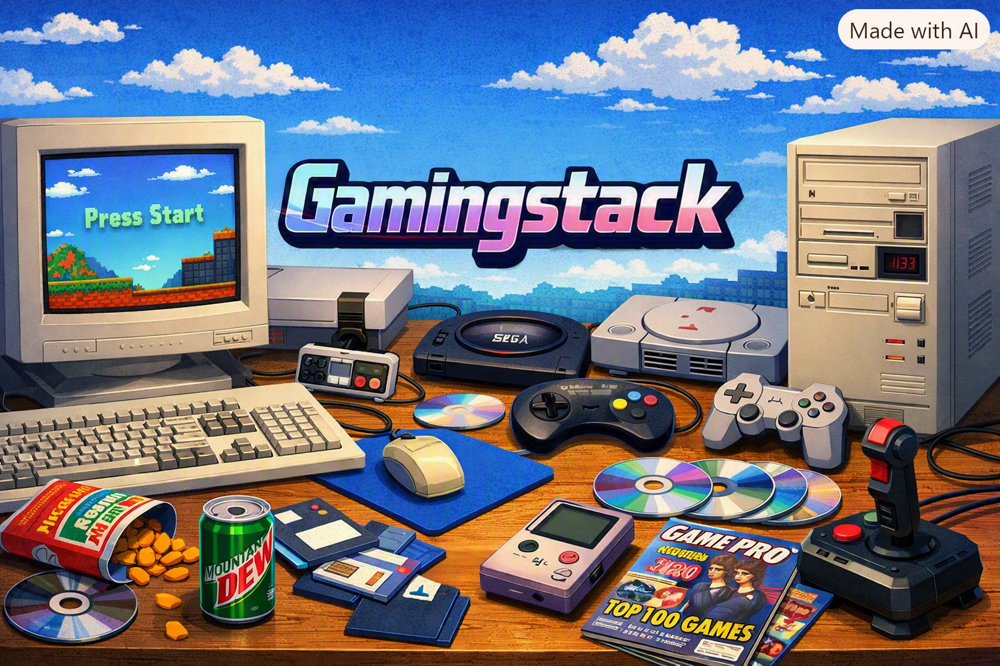
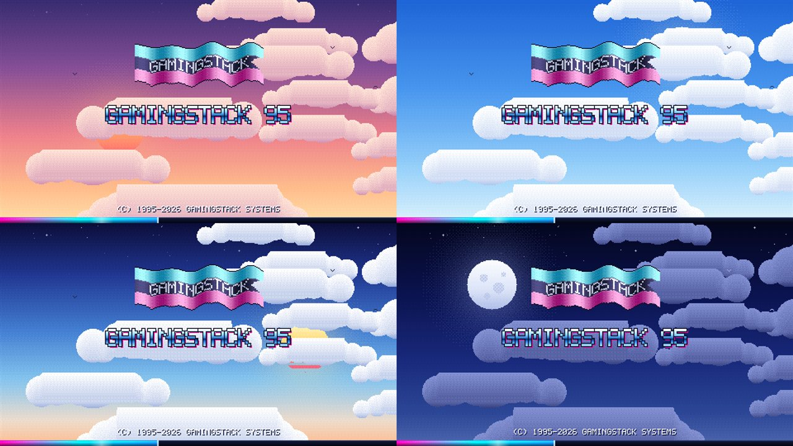
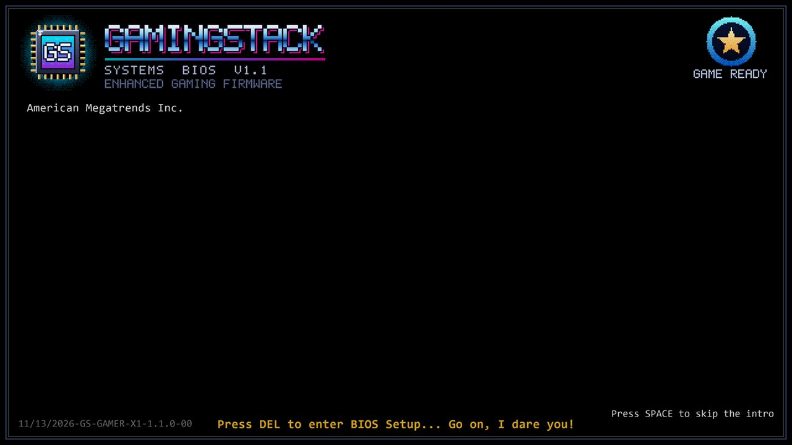
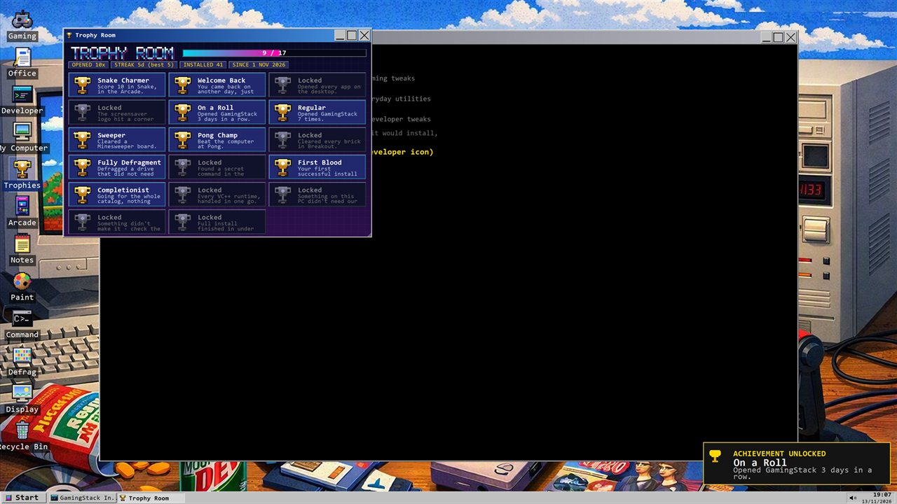
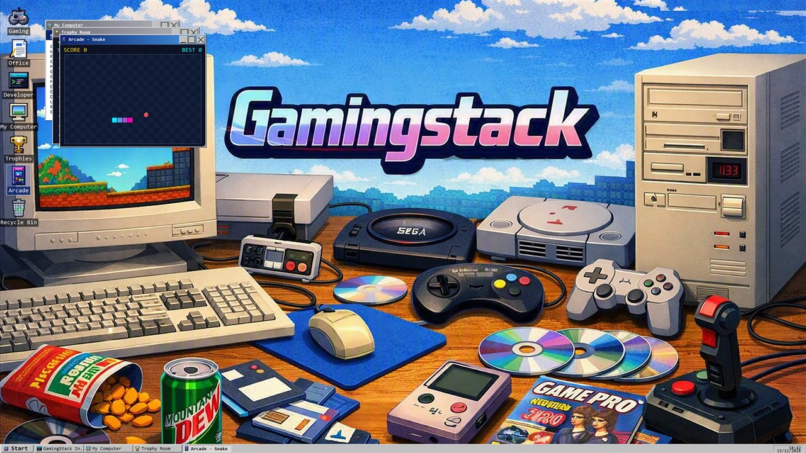

# GamingStack

[](LICENSE)


[](CHANGELOG.md)
[](https://github.com/morpheus2n2/GamingStack/releases)
[](SECURITY.md)

**A new-PC setup tool that is actually fun.** GamingStack boots through a fake 90s BIOS, a retro
boot screen and a tiny custom "retro OS" desktop - then installs everything you need for a
**Gaming / Streaming PC**, an **Office computer** or a **Developer / Home-lab** machine, with the
settings tweaks you choose, and tells you exactly what it is doing the whole way. Download one
file, run it, walk away (or stay and play Snake).

Other setup scripts are straight to the point. This one has a defined purpose too - but it makes
getting there interesting, and gives you a reason to open it again afterwards.



## Highlights

- **Three setup types.** Pick Gaming, Office or Developer and get a matching app list (~95, ~46
  and ~81 apps - see the [full catalog](docs/CATALOG.md)).
- **You stay in control.** Nothing happens until you agree to it. A *final check* screen lists
  everything that is about to happen and needs you to type `GO`.
- **Always a safety net.** A System Restore point is created first, every time. Optional full
  disk-image backup. Every Windows tweak shows its current value first and can be undone.
- **Everything is logged.** A timestamped log of the whole run is saved to
  `Documents\GamingStack\logs`, and you can press `C` to stop mid-way.
- **Real hardware on the BIOS screen.** Your actual motherboard, CPU, RAM, GPU and drives.
- **A tiny retro OS.** Movable windows, Start menu, draggable icons, Notes, Paint, Command Prompt,
  four arcade games, a screensaver, trophies and secrets - all drawn in one self-contained exe.
- **One file.** No scripts, no installer, no extra assets to lose. Self-contained .NET 8.

| BIOS | Desktop and trophies |
|---|---|
|  |  |

## Quick start

1. Download `GamingStackGUI.exe` from the [latest release](https://github.com/morpheus2n2/GamingStack/releases/latest).
2. Double-click it and accept the administrator prompt (it needs admin to install apps and change
   the settings you approve).
3. Windows SmartScreen may warn that the app is unrecognised - it is a new, unsigned open-source
   program. Click **More info > Run anyway** if you are happy with it. You can read the
   [security notes and scan results](SECURITY.md) first, or build it yourself from source.
4. Press **SPACE** to skip the intro, choose your setup type and follow the screens.

**Requirements:** Windows 10 or 11 (64-bit), an internet connection for installs, and *winget*
(App Installer - already on Windows 11 and recent Windows 10). **Esc** closes the app at any time
(it is blocked while a backup or install is actually running).

## How a run works

| Step | What happens |
|---|---|
| 1. Intro | Fake BIOS (real hardware info) > retro boot screen > the desktop. SPACE skips it. |
| 2. Choose a setup type | Gaming, Office or Developer. Or `R` to repeat your last setup. |
| 3. Choose apps | Everything shown, or go through one by one. |
| 4. Safety net | A restore point is always made. Optionally a full disk-image backup too. |
| 5. Windows tweaks | Each tweak is listed with its **real current value** and what it would become. You say yes or no. Optional DNS switch and app removal. |
| 6. **Final check** | One screen with everything that is about to happen. Type `GO` + Enter to start, or `N` to back out. |
| 7. Install | Live progress, current app, and `C` to stop after the current item. |
| 8. Summary | What was installed, opened in your browser, skipped or failed - plus where the log, build sheet and undo script are. |

### What it will never do

- Change a setting you did not see and approve on screen.
- Change anything without a way back (an undo script is saved for every run).
- Send your information anywhere. It has no telemetry. The only network use is winget, the downloads
  listed in the log, and opening vendor pages in your own browser.
- Install anything you unticked.

### Where it saves things

The exe can be run from anywhere (Downloads, Desktop, a USB stick) - it does not need to be in a
particular folder. It saves its files to **your own Windows "Documents" folder** (whatever Windows says
that is: `C:\Users\<you>\Documents`, or `...\OneDrive\Documents` if OneDrive backs it up), and to your
AppData folder. When a run finishes, the Summary screen shows the exact log path.

| What | Where |
|---|---|
| Run logs (install + backup) | `Documents\GamingStack\logs\` |
| **Undo scripts** (one per run) | `Documents\GamingStack\undo\` |
| Build sheet (plain-text summary) | `Documents\GamingStack\` |
| Your progress, settings, icon positions, trophies | `%APPDATA%\GamingStack\progress.json` |
| Notes app text | `%APPDATA%\GamingStack\notes.txt` |
| Downloaded installers | `%TEMP%\GamingStack\downloads\` |

Start menu > **Setup Logs** opens the logs folder.

## Windows tweaks

All optional, all explained on screen, all reversible. Gaming-only tweaks are never offered on the
Office or Developer setup types.

**Every setup type:** show file extensions, show hidden files, classic right-click menu, hide the
Taskbar widgets button / search box / Copilot button, hide Start-menu suggestions, turn off
Delivery Optimization (peer-to-peer update sharing), turn off the DiagTrack telemetry service.

**Gaming only:** Game Mode on, hardware-accelerated GPU scheduling on, High or Ultimate Performance
power plan, background-CPU reservation (MMCSS) to 0%, Fast Startup off, Windows Update active hours
16:00-23:00, Xbox Game Bar / Game DVR off, Nagle's algorithm off, mouse acceleration off, CPU core
parking off, foreground-app priority boost.

**Developer only:** long file paths on, Developer Mode on.

**Optional extras (you choose):** switch DNS to Cloudflare, Google or Quad9; remove selected
preinstalled Store apps (News, Weather, Clipchamp, Solitaire, Teams, the Office hub, TikTok,
Disney+, Spotify) - only the ones actually on your PC, none ticked by default, and the undo script
reinstalls them from the Store.

## Restore point and backup

A System Restore point is **always** created before anything changes. GamingStack tries Windows'
own restore-point call first and, if that fails, turns System Restore on for the system drive and
tries again. Optionally it also takes a full disk-image backup (`wbadmin`) to a drive you pick,
either before the changes or after setup; the backup runs to completion before the next step so it
is a clean snapshot. The summary tells you whether each one really worked - it never assumes.

## The retro desktop

After the boot screen you are on a small desktop made entirely inside the one window:

- **Windows** you can drag, resize, minimise, maximise and close, with taskbar buttons.
- **Start menu** and **icons** you can double-click and drag around (positions are remembered);
  right-click the desktop for a small menu.
- **Apps:** My Computer (real hardware and drive usage), Trophy Room, Arcade (Snake, Minesweeper,
  Pong, Breakout), Notes, Paint, Disk Defragmenter (a toy), Command Prompt, Display Properties and
  a Recycle Bin.
- **Screensaver** after a few idle minutes (a bouncing logo - a corner hit is a secret trophy).
- **Trophies** for installing, playing and exploring, plus a few hidden ones. In the Command
  Prompt, type `HINT` if you want a clue to the secret commands.
- **Display Properties** lets you pick the boot colours (time-of-day, dawn, day, evening, night),
  boot style, UI scale and screensaver delay.



Settings you can also set with environment variables: `GAMINGSTACK_BOOT_THEME`
(`dawn|day|evening|night`), `GAMINGSTACK_BOOT_STYLE` (`classic|landscape`) and
`GAMINGSTACK_UI_SCALE` (`1`, `1.25`, `1.5`, `2` ...).

## What it can install

The complete, always-up-to-date list is in **[docs/CATALOG.md](docs/CATALOG.md)** (generated from the
code). A taste:

- **Gaming:** Steam, Epic, GOG Galaxy, EA app, Battle.net, Playnite, OBS, Streamlabs, Discord,
  NVIDIA App, HWiNFO, MSI Afterburner, OCCT, FanControl, iCUE, OpenRGB, RetroArch, 86Box, VC++ and
  DirectX runtimes...
- **Office:** Firefox/Chrome/Brave, Microsoft 365, LibreOffice, Acrobat/Foxit/PDFgear, Teams, Zoom,
  Slack, Dropbox, Bitwarden, Malwarebytes, GIMP, Paint.NET...
- **Developer:** Git, VS Code, Visual Studio, JetBrains Toolbox, Docker Desktop, WSL, Node, Python,
  .NET, Go, Rust, Java, PostgreSQL, Terraform, kubectl, Wireshark, WireGuard, Tailscale...

Apps with **no winget package** (some vendor driver suites) are shown as "opens download page":
GamingStack opens the vendor's own https page in your default browser and you install from there.

## Building from source

```bash
git clone https://github.com/morpheus2n2/GamingStack.git
cd GamingStack
dotnet restore
dotnet run                                  # Debug build, no admin prompt (installs/tweaks need admin)
dotnet publish -c Release -r win-x64        # one self-contained GamingStackGUI.exe (asks for admin)
```

Needs the [.NET 8 SDK](https://dotnet.microsoft.com/download) on Windows. The published exe is in
`bin/Release/net8.0-windows/win-x64/publish/`. Tagging a version (`v1.6.0`) builds and attaches the
exe to a GitHub Release automatically. `python tools/gen-catalog.py` regenerates the catalog page.

Project rules and architecture notes are in [CLAUDE.md](CLAUDE.md) - read it before changing
anything structural (it explains *why* it is one process with no helper scripts).

## Documentation

- [Wiki](https://github.com/morpheus2n2/GamingStack/wiki) - guides, safety, FAQ, troubleshooting
- [CHANGELOG](CHANGELOG.md) - what changed in each version
- [ROADMAP](ROADMAP.md) - what is planned
- [SECURITY](SECURITY.md) - safety notes, how to report a problem, antivirus scan results
- [CONTRIBUTING](CONTRIBUTING.md) - how to help

## Safety note

GamingStack changes things on your PC when you tell it to. It shows you everything first, makes a
restore point, writes an undo script and a log - but it is still your machine. Read the
screens, and if you are unsure, say no (or press `N` on the final check). Use at your own risk; see
the [license](LICENSE).

## Credits and copyright

All the boot art, BIOS logo, icons, games and sound effects are original work generated in code,
and the retro look is an affectionate homage - no Microsoft logos or Windows boot animations are
copied. Two embedded files were *supplied by the project owner* rather than generated: the desktop
wallpaper (AI-generated; it shows retro hardware that may carry real-world product names) and the
boot chime `Resources/win95.wav`. Their licensing is the owner's responsibility - replace them with
your own if you redistribute this project. Windows is a trademark of Microsoft; all other product
names belong to their owners.

Built by Paul ([@morpheus2n2](https://github.com/morpheus2n2)) with Claude.

## License

[MIT](LICENSE)
