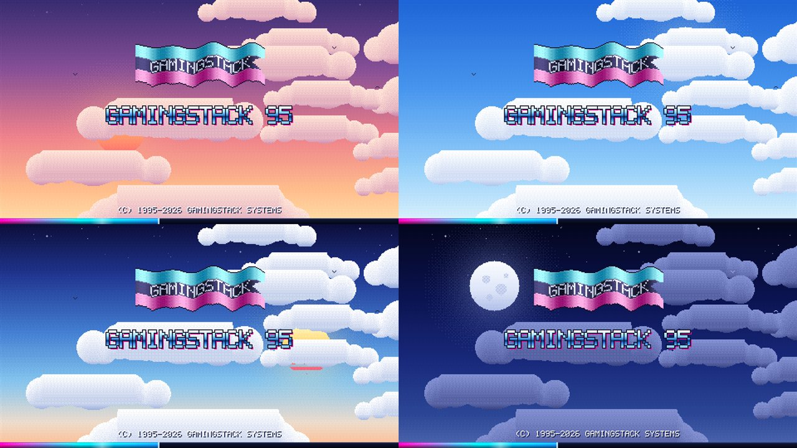

# GamingStack

**A new-PC setup tool that is actually fun.** It boots through a fake 90s BIOS and a retro boot screen
into a tiny retro "OS" desktop, then installs everything you need for a **Gaming / Streaming PC**, an
**Office computer** or a **Developer / Home-lab** machine - with the Windows tweaks *you* choose - and
shows you exactly what it is doing the whole way.

## Start here

- [Getting Started](Getting-Started) - download, run, first steps
- [Setup Types](Setup-Types) - Gaming vs Office vs Developer
- [What It Changes](What-It-Changes) - every Windows tweak, in plain words
- [Safety and Undo](Safety-and-Undo) - restore point, backup, undo scripts, the final check
- [Logs and Files](Logs-and-Files) - where everything is saved
- [The Retro Desktop](The-Retro-Desktop) - windows, apps, games, trophies
- [App Catalog](App-Catalog) - the full list of what can be installed
- [FAQ](FAQ) and [Troubleshooting](Troubleshooting)
- [Security and Scans](Security-and-Scans)

## The promise

- **You stay in control.** Nothing is installed or changed until you agree, and a *final check* screen
  lists everything first.
- **A way back.** A System Restore point every time, optional full disk backup, and an undo script for
  every tweak.
- **No secrets.** It is open source, has no telemetry and keeps a full log of what it did.

Source code and downloads: <https://github.com/morpheus2n2/GamingStack>
