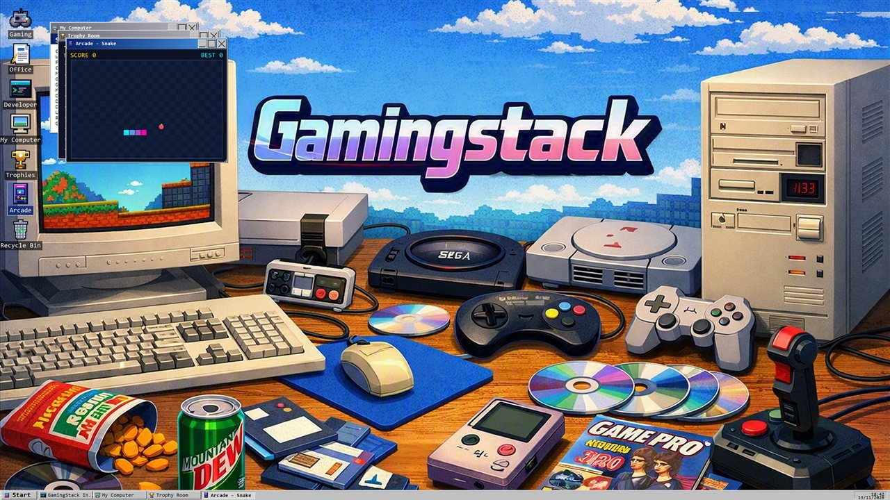

# The Retro Desktop

After the boot screen you land on a small desktop that lives entirely inside the one GamingStack window.
It is there for fun - and so there is a reason to open GamingStack again after your PC is set up.

## Basics

- **Windows**: drag by the title bar, resize from the bottom-right corner, minimise, maximise (or
  double-click the title bar) and close. Each open window has a taskbar button.
- **Icons**: click to select, double-click to open, **drag to rearrange** (positions are remembered).
  Right-click the bare desktop for *Arrange icons*, *Display Properties* and *Command Prompt*.
- **Start menu**: Setup Wizard, My Computer, Trophies, Arcade, Notes, Command Prompt, Display Properties,
  Setup Logs and Shut Down.
- **Gaming / Office / Developer icons**: double-click one to start the installer with that setup type.

## Apps

| App | What it is |
|---|---|
| My Computer | Your real hardware, drive usage bars and session info. Grows when you maximise it. |
| Trophy Room | Your trophies as little cabinet cards, with stats (times opened, streak, apps installed). |
| Arcade | Snake, Minesweeper, Pong and Breakout, each with its own trophy and best score. |
| Notes | A text pad that saves itself. |
| Paint | A small pixel paint program. |
| Disk Defragmenter | A toy that tidies coloured blocks. Your drive is 0% faster. |
| Command Prompt | Real commands (HELP, VER, DIR, NEOFETCH, ...) plus launchers and some secret ones. |
| Display Properties | Boot colours, boot style, UI scale and screensaver delay. |
| Recycle Bin | Empty. Nothing is ever thrown away. |

## Screensaver

After a few idle minutes (set in Display Properties) a starfield flies past with a bouncing GAMINGSTACK
logo. It never starts while a backup or install is running. Press any key or move the mouse to wake it.

## Trophies

Earned for installing, playing, exploring and coming back on another day. A few are hidden. Stuck on the
secret commands in the Command Prompt? Type `HINT` for a clue and `SECRETS` to see your progress.
